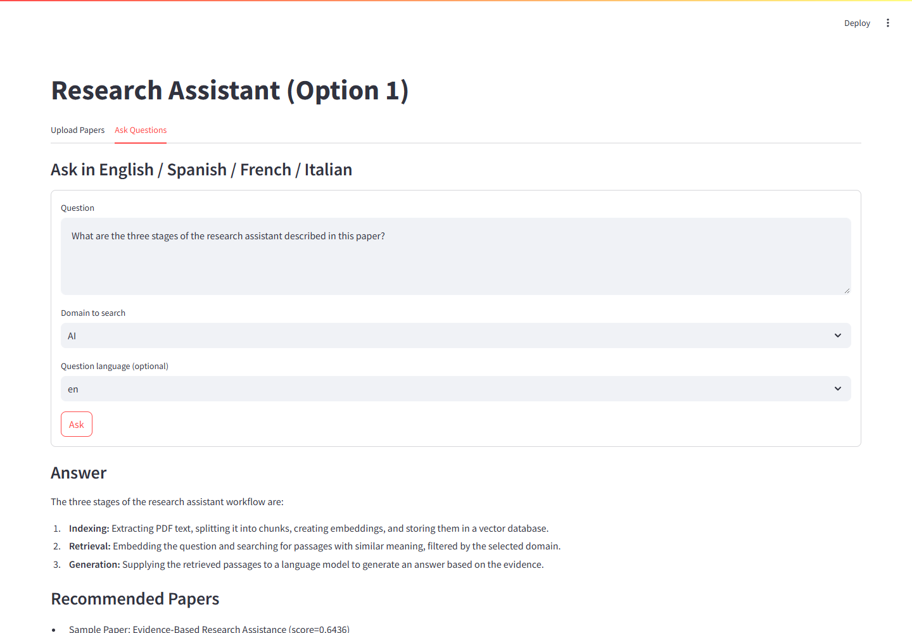
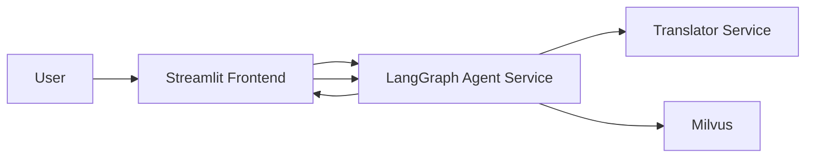

# AI-Research-Assistant-Agents on GKE

**Author: Ajith Reddy**

## Local setup

Run commands from this directory (the one containing this README).
Install Docker Desktop with its Linux engine running. Save a Google Gemini API
key in `.env` as `GOOGLE_API_KEY=...` (copy `.env.example` to `.env` first).
The key needs access and quota for the
configured generation and embedding models. No separate Milvus API key is needed
for the local database. Keep `.env` private; Git ignores it.

The local stack uses the existing service Dockerfiles and Milvus 2.5.26 with
embedded etcd and local storage, adapted from the official
[standalone installation script](https://github.com/milvus-io/milvus/blob/v2.5.27/scripts/standalone_embed.sh).
Published ports bind to localhost. Docker Compose reads `.env` and
passes the settings into the agent. Internal service addresses override the
localhost values in `.env` inside the containers.

```powershell
docker compose -f compose.milvus.yaml -f compose.yaml up -d --build
docker compose -f compose.milvus.yaml -f compose.yaml ps
```

Open **http://127.0.0.1:8501**. Upload a PDF in the Upload Papers tab, select its
domain and language, and index it before asking questions in that same domain.
The external sample PDFs linked below are optional and are not bundled here.

| Service | Local address |
| --- | --- |
| Streamlit | http://127.0.0.1:8501 |
| Agent health | http://127.0.0.1:8080/healthz |
| Translator health | http://127.0.0.1:8000/healthz |
| Milvus health | http://127.0.0.1:9091/healthz |
| Milvus vector connection | `127.0.0.1:19530` |

```powershell
# Inspect startup failures
docker compose -f compose.milvus.yaml -f compose.yaml logs --tail 100 agent translator standalone
# Stop containers; indexed data remains under volumes/
docker compose -f compose.milvus.yaml -f compose.yaml down
```

For host-based Python development, the agent and frontend automatically load the
root `.env` without overriding existing environment variables. Install their
dependencies in an isolated environment:

```powershell
python -m venv .venv
.\.venv\Scripts\python.exe -m pip install -r agent-service/requirements.txt -r frontend/requirements.txt
.\.venv\Scripts\python.exe -m streamlit run frontend/app.py --server.address 127.0.0.1 --server.port 8501
```

The frontend alone does not start the agent or database. Stop a host frontend
before starting the Compose frontend on the same port. The translator has its
own dependency set and runs in its own container.

## Verification evidence — November 9, 2026

These results describe this local session.

| Check | Observed result |
| --- | --- |
| Git repository | Initialized in this project directory |
| Secret configuration | Nonempty Gemini key detected; value was not printed |
| Dependency installation | Agent and frontend dependencies installed in `.venv` |
| Dependency consistency | `pip check`: no broken requirements found |
| Python syntax | All 11 service Python files and the recording script parsed successfully |
| Environment loading | Agent configuration loaded the saved key from `.env` |
| Gemini models | Both configured models returned HTTP `200` for live embedding and generation requests |
| Text chunking | A 4,800-character sample produced 7 chunks |
| Compose files | `docker compose ... config --quiet` passed; all four configured service dependencies resolve |
| Docker engine | Docker server reported version `29.9.2` after startup |
| Frontend startup | Streamlit started at `http://127.0.0.1:8501` |
| Frontend health | `GET /_stcore/health` returned HTTP `200` and `ok` |
| Frontend rendering | Streamlit AppTest rendered the page with zero exceptions |
| Backend startup | Agent, translator, and Milvus containers running and healthy; each health endpoint returned HTTP `200` |
| PDF ingestion, retrieval, and generated answers | Real English UI workflow succeeded: sample PDF indexed, relevant passages retrieved, and Gemini answered with all three expected stages |
| Reference exclusion | Sample bibliography sentinel was absent from extracted text |
| Demo recording | 34.28-second WebM, 1440 x 1000, 25 fps; screenshot and response evidence saved under `docs/demo/` |

The recorded session used a host Streamlit frontend and containerized backend.
The Compose frontend image and multilingual translation were not exercised in
this recording. Live Gemini requests succeeded with the saved key; future quota
and availability can vary. The installed Google SDK emits
deprecation warnings with the current dependency pins. The Dockerfiles use
Python 3.12; the host checks used Python 3.10.11.

## Original project overview and cloud deployment

- Streamlit frontend
- LangGraph-based Agent service
- Translator service (FastAPI + googletrans)
- Milvus vector database on GKE
- 30 PDFs already categorized into AI, Security, Other, you can fine them on: https://cmu.box.com/s/73bv9vlxhcznyf38zmyie077yd0i3iwr
## Demo video

**Ajith Reddy - recorded November 9, 2026.**

[Watch the sample demonstration (WebM, 34 seconds)](docs/demo/sample-demo.webm)

[](docs/demo/sample-demo.webm)

The recording shows a real PDF upload, successful indexing, and a generated
answer with source-paper recommendations. No responses are mocked.

- Input: [synthetic sample PDF](docs/demo/sample-paper.pdf), domain `AI`, language `en`.
- Question: "What are the three stages of the research assistant described in this paper?"
- Observed answer: indexing, retrieval, and generation, with explanations grounded in the sample.
- [Recorded response evidence](docs/demo/evidence.json).

The PDF is a demonstration input authored for this recording, not a published
research study. The silent video captures only the application; API keys are
not displayed.

To repeat the recording with the backend and frontend running, install the demo
dependencies and Playwright's video encoder. The script uses an installed
Microsoft Edge browser and writes the video, screenshot, PDF, and evidence into
`docs/demo/`. Each run indexes the sample again.

```powershell
.\.venv\Scripts\python.exe -m pip install -r requirements-demo.txt
.\.venv\Scripts\python.exe -m playwright install ffmpeg
.\.venv\Scripts\python.exe scripts/record_demo.py
```

## Architecture Diagram



## 1) Project Structure

- `Docker-NLP/`: Translator service
- `agent-service/`: LangGraph orchestration + PDF ingestion + RAG
- `frontend/`: Streamlit UI
- `milvus-gke/`: Existing Terraform for Milvus deployment on GKE
- `infra/k8s/`: K8s manifests for translator/agent/frontend + HPA

## 2) Data/Schema Design

Milvus collection fields:

- `id` (Primary Key)
- `paper_title` (String)
- `domain` (String: `AI` / `Security` / `Other`)
- `language` (String: `en`, `es`, `fr`, `it`)
- `text_chunk` (String)
- `embedding` (FloatVector)

## 3) Important Parsing Rule (No References Indexing)

In `agent-service/app/pdf_utils.py`, the ingestion logic stops parsing once it sees a heading matching:

- `References`
- `Bibliography`

Everything after that heading is discarded before chunking/embedding.

## 4) GKE Deployment Roadmap

### Stage 1: Containerization + Artifact Registry

Build and push three images:

- `translator`
- `agent`
- `frontend`

Procedure:
1) Configure GCP and repository variables
```bash
export PROJECT_ID="your-gcp-project-id"
export REGION="us-central1"
export ZONE="us-central1-a"
export REPO_NAME="option1"
export CLUSTER_NAME="option1-gke"

gcloud auth login
gcloud config set project $PROJECT_ID
gcloud services enable container.googleapis.com artifactregistry.googleapis.com

gcloud artifacts repositories create $REPO_NAME \
  --repository-format=docker \
  --location=$REGION

gcloud auth configure-docker ${REGION}-docker.pkg.dev
```

### Stage 2: Infrastructure + HPA + Internal Services
First upload the entire folder (milvus-gke) to the Google Cloud CLI environment.
1. Deploy Milvus using your existing `milvus-gke/`.
```bash
cd milvus-gke
terraform init
terraform apply -var="project_id=$PROJECT_ID" -var="zone=$ZONE" -var="region=$REGION"

kubectl get svc -n milvus
kubectl get pods -n milvus
```
2. Build and push 3 images
Translator
```bash
docker build -t ${REGION}-docker.pkg.dev/${PROJECT_ID}/${REPO_NAME}/translator:latest Docker-NLP
docker push ${REGION}-docker.pkg.dev/${PROJECT_ID}/${REPO_NAME}/translator:latest
```
Agent
```bash
docker build -t ${REGION}-docker.pkg.dev/${PROJECT_ID}/${REPO_NAME}/agent:latest agent-service
docker push ${REGION}-docker.pkg.dev/${PROJECT_ID}/${REPO_NAME}/agent:latest
```
Streamlit
```bash
docker build -t ${REGION}-docker.pkg.dev/${PROJECT_ID}/${REPO_NAME}/frontend:latest frontend
docker push ${REGION}-docker.pkg.dev/${PROJECT_ID}/${REPO_NAME}/frontend:latest
```

3. Connect to the GKE cluster and deploy the application
```bash
gcloud container clusters get-credentials $CLUSTER_NAME --zone $ZONE --project $PROJECT_ID

cd infra/k8s
kubectl apply -f namespace.yaml
kubectl apply -f configmap.yaml
kubectl apply -f secret.example.yaml
kubectl apply -f milvus-alias-service.yaml
kubectl apply -f translator.yaml
kubectl apply -f agent.yaml
kubectl apply -f frontend.yaml

kubectl get pods -n option1
kubectl get svc -n option1
kubectl get hpa -n option1

kubectl logs -n option1 deploy/translator
kubectl logs -n option1 deploy/agent
kubectl logs -n option1 deploy/frontend
```
4.Test each service individually
Translator
```bash
kubectl port-forward -n option1 svc/translator-svc 8000:8000
```
Use another terminal：
```bash
curl http://127.0.0.1:8000/healthz
curl -X POST http://127.0.0.1:8000/detect-language \
  -H "Content-Type: application/json" \
  -d '{"text":"Hola, como estas?"}'
```
Agent
```bash
kubectl port-forward -n option1 svc/agent-svc 8080:8080
curl http://127.0.0.1:8080/healthz
```
Streamlit
```bash
kubectl get svc -n option1 frontend-svc
```

5. Internal DNS-based access:
   - Translator: `http://translator-svc.option1.svc.cluster.local:8000`
   - Milvus: `milvus-svc.option1.svc.cluster.local:19530` (via `ExternalName` alias)

6. HPA is configured for `translator` and `agent`:
   - min replicas: 1
   - max replicas: 5
   - CPU threshold: 70%

### Stage 3: Limitations and Design Decisions
Limitations
- `googletrans` may occasionally fail due to upstream limitations.
- PDF text extraction quality depends on document formatting.
- Current answer grounding is context-only prompting
- stronger hallucination controls can be added with citation-by-span checks.
- Benchmarks depend on current data volume and cluster resource state.

Design Decisions
- I implemented a LangGraph-based custom tool calling agent
- Streamlit + Agent + Translator + Milvus: The system is split into independent services: Streamlit frontend, LangGraph-based agent, translator API, and Milvus vector database. This keeps responsibilities clear and simplifies deployment, scaling, and debugging on GKE.
- Agent as the single orchestrator: The frontend communicates only with the agent. The agent handles translation, retrieval, and answer generation. This centralizes workflow logic and enforces a consistent API contract.
- Multilingual workflow via translation pivot: User queries are detected/translated into English for retrieval and generation, then translated back to the user’s original language (en/es/fr/it). This improves retrieval consistency with a single embedding/query pipeline.
- Hallucination-aware generation strategy: The generation prompt instructs the model to answer only from retrieved context and explicitly acknowledge insufficient evidence. This reduces unsupported claims.
- Reference-section exclusion during ingestion: PDF parsing stops at References / Bibliography, and all subsequent content is discarded before chunking and embedding. This prevents bibliography-only chunks from polluting retrieval.
- Domain-aware retrieval with explicit metadata schema: Milvus stores id, paper_title, domain, language, text_chunk, and embedding. Queries apply a domain filter (AI/Security/Other) to improve relevance and align with project requirements.
- Kubernetes networking and exposure policy: translator and agent use internal ClusterIP services; frontend uses LoadBalancer. This minimizes public exposure while keeping user access simple.
